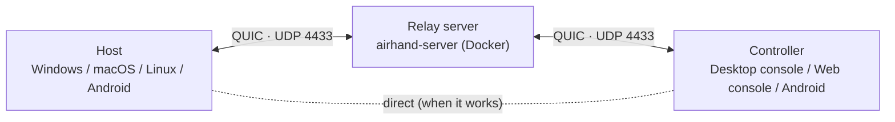

<p align="center"></p>

<h1 align="center">Airhand</h1>

<p align="center"><b>High-performance, low-latency remote desktop</b><br>QUIC transport · hardware encoding and decoding · up to 120 fps<br>Windows · macOS · Linux · Android · browser</p>

<p align="center">
  <a href="https://github.com/jiqing112/airhand/releases"></a>
  <a href="https://github.com/jiqing112/airhand/actions/workflows/release.yml"></a>
  <a href="LICENSE"></a>
</p>

<p align="center"><a href="README.zh-CN.md">简体中文</a> · <b>English</b></p>

---

Airhand is a **high-performance, low-latency remote desktop**: frames are hardware-encoded on the GPU (AV1 / HEVC / H.264) at up to 120 fps and transported over QUIC; when the network slows down it jumps straight to the newest frame, so latency never piles up; the mouse pointer is drawn locally, so moving it feels instant.

This repository is a fork of [sqlpxc/airhand](https://github.com/sqlpxc/airhand), maintained as a **standalone project** (same protocol and codebase, MIT), with its own features and experience improvements — see [Changes in this fork](#changes-in-this-fork).

## Changes in this fork

- **LAN direct connections**: works without a relay server (isolated networks, ad-hoc setups) — the host enables a `[lan]` listener in `config.toml`, and the controller connects straight to `IP:port`. End-to-end encryption, pairing codes and identity memory are identical to the relayed flow; devices you've connected are remembered for one-click reconnect (see [LAN direct connections](docs/usage.md#局域网直连))
- **Light theme + five palettes**: graphite light by default (warm paper canvas + fine grid + white glass), with clay / celadon / mist / dusk palettes one switch away; the remote-video area stays black (see [UI guidelines](docs/ui.md))
- **Redesigned connect page**: one input for both targets (a 6-digit code goes through the server, `IP:port` connects directly), all secondary copy removed; pasting 12 digits splits code + pairing code automatically
- **Windows fix**: double-clicking the tray icon now opens the console (previously a left-click only worked in controller mode)
- **CI/CD**: GitHub Actions builds the Windows / macOS / Linux installers and the relay server binaries; pushing a `v*` tag publishes a Release automatically (see [.github/workflows/release.yml](.github/workflows/release.yml))
- **Design guidelines**: design tokens (radii, 4 px spacing scale, type) and component-semantics Do / Don'ts (see [UI guidelines](docs/ui.md))

## Download

Grab the latest build from [Releases](https://github.com/jiqing112/airhand/releases):

| File | What it is |
|---|---|
| `Airhand_…_windows-x64-setup.exe` | Windows installer (registers a system service; controllable right after boot) |
| `Airhand_…_macos-arm64.dmg` | macOS (Apple silicon); see the signing note under Build |
| `Airhand_…_linux-amd64.deb` / `…_linux-x64` | Linux package / single file |
| `airhand-server-….tar.gz` | Relay server binary |

The relay address baked into these installers is the code default (`127.0.0.1:4433`, empty fingerprint = trust on first use). After installing, point it at your own server in [`config.toml`](docs/usage.md#配置文件); to build an installer that connects out of the box, set the repository Variables (`AIRHAND_SERVER` / `AIRHAND_SERVER_FP`) and push a new tag.

> [!NOTE]
> **Work in progress (0.3.1).** Build the relay, clients and web service from the same v10 revision; earlier builds cannot be mixed. Video uses one QUIC stream per frame. [Protocol versions](docs/development.md#protocol-versions)

## Performance

Every step from capture to display is designed for low latency:

- **Hardware encoding and decoding**: the host encodes on the GPU (NVENC / Quick Sync / AMF, VideoToolbox, MediaCodec) in low-latency mode without B-frames; the controller decodes on the GPU (WebCodecs / MediaCodec). Measured with a 4K screen streamed at 1080p, hardware AV1 encoding takes about 7 ms per frame (RTX graphics card)
- **The best format**: AV1 > HEVC > H.264, automatically picking the most efficient format both sides support; scaling and color conversion use SIMD, and all buffers are reused
- **No lag build-up**: the host limits the bytes in flight (≈ bitrate × (RTT + 50 ms)) and skips to the latest frame on a slow network; the bitrate follows the measured queueing delay and bandwidth on every acknowledgement, backing off within a few hundred milliseconds and recovering gradually
- **Direct path**: besides the relay, the two ends punch a direct path through their NATs (on the same LAN, or whenever the NAT isn't symmetric), so video and audio stop detouring through the server; the lower-latency path is picked automatically, and if the direct path breaks the session falls back to the relay without dropping
- **QUIC + BBR**: BBR congestion control is steadier than Cubic on lossy networks such as Wi-Fi or long-distance links; control messages, audio and video are queued separately, so mouse input and pings never wait behind a large frame; the relay only forwards bytes and never parses the video
- **Loss doesn't stall the picture**: each frame travels on its own QUIC stream, so a lost packet only holds up that frame. A frame that keeps not arriving is abandoned (no more retransmitting stale data) and the encoder continues from a long-term reference frame the controller already has (reference invalidation) instead of sending a large keyframe (Windows H.264, NVIDIA AV1; other encoders send a keyframe)
- **Decode and show**: the decoder runs in low-latency mode, and each frame is drawn to a desynchronized canvas as soon as it's decoded, without waiting for vsync
- **Local pointer**: the remote cursor's shape is mirrored locally, and moving it happens locally
- **Low bandwidth**: no frames are sent while the screen is still, so an idle desktop uses almost nothing; sessions that aren't on screen drop to 5 fps

See [How it works → Video](docs/architecture.md#画面).

## Features

- **LAN direct connections**: no relay server needed — connect to `IP:port` on the same network (new in this fork, see [LAN direct connections](docs/usage.md#局域网直连))
- **Windows system service**: the lock screen, the sign-in screen and UAC prompts can be seen and controlled, and the computer can be reached after boot, before anyone signs in
- **Fixed control codes**: they survive restarts, upgrades and even server restarts until you change them yourself
- **Console**: browser-style tabs to control several computers at once, plus a multi-screen overview to watch them all. Computers you've connected to are saved and reconnect with one click; if one is offline, it connects as soon as it comes back
- **Web console**: the controller can also run in Docker and be used from a browser, with nothing to install on the computer you control from
- **Android**: control computers and phones from a phone as a trackpad or touchscreen, or share your own screen to get help (a device needs the pairing code shown on the phone the first time, and you're notified whenever one connects); watch on a TV with the remote
- **Audio**: the host's system audio plays on the controller (Opus + adaptive jitter buffer), with optional A/V sync for watching videos. The other way, the controller can send its microphone to meeting apps and voice typing on Windows, macOS 14.2+ and Linux (PipeWire) hosts. Mac and Linux hosts publish **Airhand Microphone** while forwarding is on
- **Handy tools**: two-way clipboard sync (text, plus files and folders, sent when you paste), typing the clipboard as keystrokes, system shortcuts (Win, Alt+Tab, Ctrl+Shift+Esc…), multiple monitors (switch between them, show and control several at once, or give each its own window to put on your own screens in full screen), keyboard lock in fullscreen, quality presets
- **Secure by default**: sessions are end-to-end encrypted, so the relay server can't see the screen or keystrokes; the first connection needs the pairing code from the other computer's tray (it never goes through the server), and its identity is recognized afterwards; TLS 1.3 with certificate pinning, brute-force protection for control codes; the host always sees who is connected and can disconnect them with one click
- **Leaves nothing behind**: the host is just a tray icon and doesn't start a WebView; everything worth keeping is in one `config.toml`, other runtime files are deleted on exit, and nothing is left after [uninstalling](docs/usage.md#uninstalling) (Windows has an uninstaller, macOS has "Uninstall Airhand…" in the menu, Linux takes two commands)
- **English and Chinese**: follows the system language; notices from the other computer and the server also appear in **your** language

## Supported platforms

| Platform | Host | Controller | Notes |
|---|:-:|:-:|---|
| Windows 10 / 11 | ✅ | ✅ | Install required; the host runs as a system service |
| macOS 13+ | ✅ | ✅ | The host needs Screen & System Audio recording and Accessibility permissions |
| Linux | ✅ | ✅ | Host supports X11 only, software encoding for now |
| Android 7+ phone / tablet | ✅ | ✅ | Accessibility service required to be operated, otherwise view-only; the controller connects to one machine at a time |
| Android TV / Google TV | — | Watch only | Everything with the remote |
| Browser (web console) | — | ✅ | Chrome / Edge, Safari 16.4+, Firefox 130+ |

Known issues per platform: [Known limitations](docs/limitations.md). LAN direct connections currently cover the three desktop platforms (host listener + controller dial); Android is not supported yet.

## How it works



The host connects to the relay server at startup and gets a 6-digit control code; the controller finds it by that code. The server only registers codes, matches sessions and forwards bytes; the session is end-to-end encrypted and the server can't see the content. Both ends dial the server outbound — no open ports, no public IP. After the session starts both ends also try to punch a direct connection; if it works, video stops detouring through the server. See [How it works](docs/architecture.md).

**Without a relay server** (new in this fork): the host listens for QUIC on a local port, the controller dials `IP:port`, and the end-to-end handshake, pairing and session run the exact same code as the relayed flow — see [LAN direct connections](docs/usage.md#局域网直连).

## Quick start

You need:

- A machine reachable from both ends with Docker, exposing **UDP 4433** (skip this for pure-LAN use, see [LAN direct connections](docs/usage.md#局域网直连))
- Rust, Node.js 20+ and CMake to build the client (per-platform dependencies under [Build](docs/building.md#dependencies))

### 1. Deploy the relay server

```bash
git clone https://github.com/jiqing112/airhand.git
cd airhand
docker compose up -d
docker compose logs airhand | grep fingerprint   # note the SHA-256 fingerprint
```

The certificate and the control-code database live in `data/` — **keep that directory**: if the certificate changes, existing clients can no longer connect. Server configuration: [Deploy](docs/deploy.md#the-relay-server).

### 2. Build the client

Bake the server address and the fingerprint from step 1 into the program (or skip this and edit `config.toml` after installing from Releases).

Windows (PowerShell):

```powershell
cd client
npm install
$env:AIRHAND_SERVER    = "relay.example.com:4433"
$env:AIRHAND_SERVER_FP = "<the fingerprint from step 1>"
npm run tauri build
```

macOS / Linux:

```bash
cd client
npm install
export AIRHAND_SERVER=relay.example.com:4433
export AIRHAND_SERVER_FP=<the fingerprint from step 1>
npm run tauri build
```

Output lands in `client/src-tauri/target/release/bundle/`:

| System | Installer |
|---|---|
| Windows | `nsis/Airhand_<version>_x64-setup.exe` |
| macOS | `macos/Airhand.app`, `dmg/Airhand_<version>_<arch>.dmg` |
| Linux | `deb/Airhand_<version>_amd64.deb` |

Alternatively push a `v*` tag and let [CI/CD](.github/workflows/release.yml) build all three platforms and publish the Release. The server address and fingerprint can also be changed later in [`config.toml`](docs/usage.md#配置文件). For the Android APK see [Build → Android](docs/building.md#androidapk).

### 3. Connect

1. Install Airhand on both machines (run the installer on Windows — admin required; grant permissions on macOS at first launch)
2. On the machine you want to **control**, right-click the tray icon (macOS: click the menu bar icon) and read the 6-digit **control code**
3. On **your** machine, open the console from the tray menu (macOS / Linux: **Switch to controller**) or just **double-click the tray icon**, and type the control code. The first time you connect to that machine you also type the 6-digit **pairing code** from its tray menu — after that you're remembered

**LAN direct connection**: enable the `[lan]` listener in the host's `config.toml` and restart it; on the controller, type the peer's `IP:port` in the connect page — see [LAN direct connections](docs/usage.md#局域网直连).

Full usage guide: [Usage](docs/usage.md).

### No install: the web console

Run the web console on any Docker machine and control from a browser:

```bash
cd web
AIRHAND_SERVER=relay.example.com:4433 AIRHAND_SERVER_FP=<fingerprint> docker compose up -d
```

Open `http://localhost:8080` on that machine, or `https://<that machine's address>:8080` from others. Password, HTTPS certificates and reverse proxy: [Deploy → Web console](docs/deploy.md#web-consolenedocker).

## Documentation

| Document | Content |
|---|---|
| [Usage](docs/usage.md) | Host, Windows install, config file, **LAN direct connections**, uninstall, console, quality, UI language |
| [UI guidelines](docs/ui.md) | Design tokens (color / radius / spacing / type), component-semantics Do / Don'ts |
| [Deploy](docs/deploy.md) | Relay server configuration, web console, reverse proxy |
| [Android](docs/android.md) | Controlling from a phone, sharing the phone, gestures, TV |
| [Build](docs/building.md) | Dependencies and installers per platform, signing, APK |
| [How it works](docs/architecture.md) | Architecture, code layout, Windows service, video and audio, A/V sync, files on disk |
| [Security](docs/security.md) | Encryption and certificate pinning, brute-force protection, control code and reconnect tokens |
| [Known limitations](docs/limitations.md) | Known issues by platform |
| [Development](docs/development.md) | Tests, debugging tools, project conventions |

## Security notes

- TLS 1.3 (QUIC) throughout; clients verify the server by certificate fingerprint. Without a fingerprint baked in, the client remembers the server's certificate on first connect and refuses to connect when it changes — that only protects the first connection, so pin the fingerprint for real deployments
- **End-to-end encryption**: screen, audio, keyboard, mouse and clipboard are encrypted between host and controller; the relay can't see or alter them — it only knows who connected to whom and how much traffic. The web console is one end of the E2E encryption, so its machine can see the screen. LAN direct connections skip the server entirely; E2E encryption and pairing apply as usual
- **Control code + pairing code**: the server knows all control codes, so the first connection also asks for the pairing code from the host's tray (it never passes through the server; five wrong tries pause pairing), and the host remembers the controller afterwards. The Windows host runs as SYSTEM — anyone who can connect operates the machine as admin; the tray shows who is connected at all times and can disconnect them, change the control code or the pairing code. LAN mode has no control code "gate": the pairing code is the only threshold, and the `[lan]` `allow` network list keeps unknown machines out before they even connect

See [Security](docs/security.md).

## Contributing

| Directory | Content |
|---|---|
| `crates/` | Protocol (`airhand-proto`) and the client↔server link (`airhand-link`); the LAN-direct protocol messages (`airhand-proto/src/lan.rs`) and listener / dialer implementations (`host/lan.rs`, `controller`) live here too |
| `server/` | Relay server |
| `web/` | Web console service |
| `client/` | Desktop client: Tauri (Rust) + React UI, shared with the web console |
| `android/` | Android app (Kotlin + Jetpack Compose) and its Rust core |

Tests, debugging tools and project conventions (protocol versions, UI copy, [UI guidelines](docs/ui.md)): [Development](docs/development.md).

## License

[MIT](LICENSE). Built on [sqlpxc/airhand](https://github.com/sqlpxc/airhand) — thanks to the original author.
